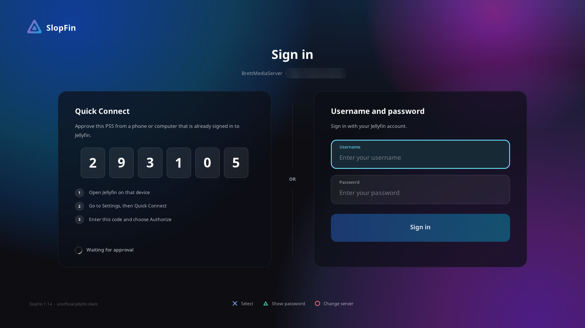
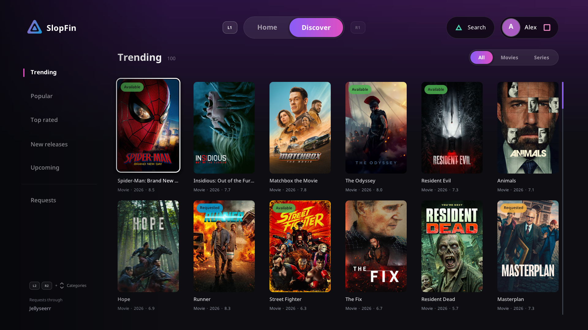
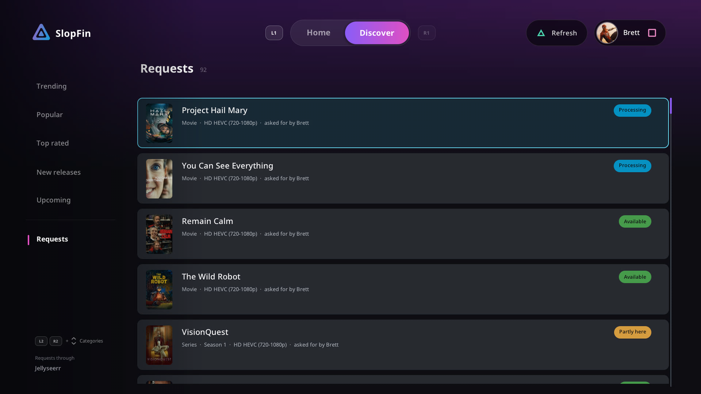

# SlopFin

**An unofficial Jellyfin client for jailbroken PS5 consoles.**

[Downloads](https://github.com/BeLikeBrett/SlopFin/releases) ·
[Install](docs/GETTING_STARTED.md) · [Controls](docs/CONTROLS.md) ·
[Compatibility](docs/COMPATIBILITY.md) ·
[Report a bug](https://github.com/BeLikeBrett/SlopFin/issues/new/choose)

SlopFin plays movies and shows from your own Jellyfin server, using the PS5's
video hardware. It has been tested on one console, on firmware 8.20; other
firmware, TVs and receivers may behave differently.

## Features

- **DualSense controls:** tap or hold L2/R2 to seek and scrub, Square to skip
  intros, L1/R1 to switch between Home and Discover.
- **Plays most files directly:** MKV and MP4 with H.264 or HEVC video stream
  straight from your server, without it converting them.
- **Sound to your TV or receiver:** Dolby and DTS go to your TV or receiver
  when it supports them; otherwise the PS5 decodes them.
- **Discover and requests:** connect Seerr or Jellyseerr to find and request
  movies and shows. [Set up Discover](docs/DISCOVER.md).
- **Autoplay, profiles and a server dashboard** for administrators.

| Sign in | Discover | Requests |
| --- | --- | --- |
|  |  |  |

## What plays

- **Video:** H.264 and HEVC, including 4K and HDR10. Dolby Vision profiles 7
  and 8.1 play as HDR10; the PS5 does not output Dolby Vision itself.
- **Sound:** AAC, MP3, AC-3, E-AC-3, DTS and TrueHD, decoded on the PS5 or by
  your TV or receiver.
- **Anything else** (other codecs, AVI and so on) is converted by your Jellyfin
  server first, so how well it plays depends on your server.

Details and known limits are in [Compatibility](docs/COMPATIBILITY.md).

## Install

1. Download the **folder ZIP** from
   [Releases](https://github.com/BeLikeBrett/SlopFin/releases).
2. Copy the `PPSA99001` folder to your homebrew loader's folder, usually
   `/data/homebrew/`.
3. Open SlopFin, enter your Jellyfin server address and sign in.

You need a jailbroken PS5 and your own Jellyfin server.
[Setup details](docs/GETTING_STARTED.md) · [Help](docs/TROUBLESHOOTING.md)

## Updates

**Settings → Updates** checks GitHub and installs new versions in the app. It
needs ELF Loader (`elfldr`, port 9021). [Update guide](docs/UPDATES.md)

## Not supported yet

Music, audiobooks, books, photos and live TV; IPv6; self-signed HTTPS
certificates.

## Contribute

See [contributing](.github/CONTRIBUTING.md) and the
[developer guide](docs/development/README.md).

## License

GPL-3.0-or-later. Built on the native-app boilerplate and ProsperoTV's
hardware-decode work; [NOTICE](NOTICE.md) lists dependencies and their
licenses. Not affiliated with Jellyfin or Sony.
