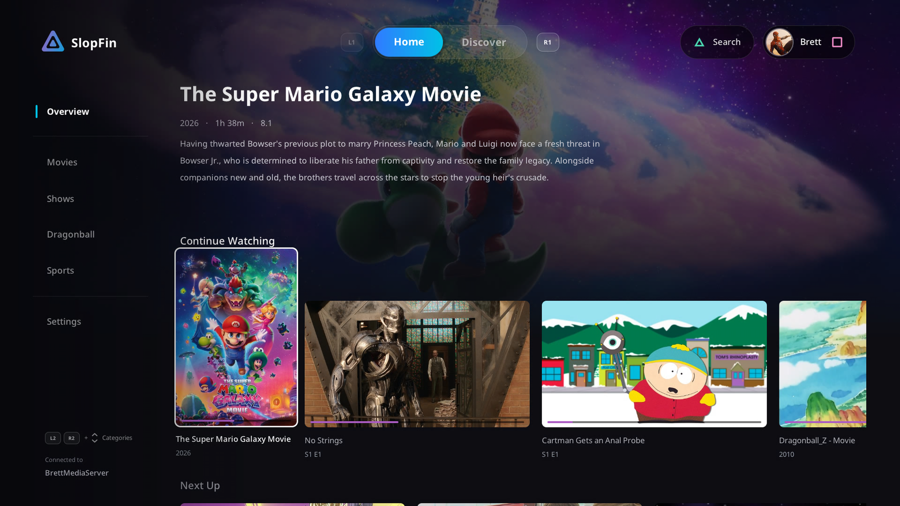

# SlopFin

**Jellyfin on PlayStation 5.** An unofficial client for jailbroken consoles.

[Download](https://github.com/BeLikeBrett/SlopFin/releases) ·
[Get started](docs/GETTING_STARTED.md) · [Controls](docs/CONTROLS.md) ·
[Compatibility](docs/COMPATIBILITY.md) ·
[Report a bug](https://github.com/BeLikeBrett/SlopFin/issues/new/choose)

Browse your library, resume a movie, and move straight into the next episode
with DualSense controls. SlopFin connects to your own Jellyfin server and uses
the PS5's video decoder for supported H.264 and HEVC media.

## Made for the couch

- **A native 4K interface**, with GPU-accelerated menus, smooth scrolling and
  controller focus throughout Home, Discover, media pages and Settings.
- **Direct playback** of supported MKV and MP4 files, including 4K and HDR10.
  Compatible Dolby Vision sources play from their HDR10 base layer.
- **Flexible sound.** Supported Dolby and DTS formats go to your TV or receiver;
  the PS5 decodes other supported tracks, with Jellyfin conversion as a fallback.
- **Subtitles you can adjust.** Six text font families, separate text, outline
  and background colours, and native PGS/DVD overlays with size and placement
  controls. [Subtitle settings](docs/SUBTITLES.md).
- **Built-in autoplay and intro skipping.** Intro skipping uses standard server
  timestamps. [Set up intro markers](docs/INTRO_SKIPPING.md).
- **Local voice search.** Speak a title using your PS5 microphone after a one-time
  model download, or type with the keyboard. [Voice controls](docs/VOICE_SEARCH.md).
- **Discover and requests** through Seerr or Jellyseerr, alongside profiles,
  progress tracking and an administrator dashboard. [Connect Discover](docs/DISCOVER.md).

## Install

You need a jailbroken PS5, a compatible homebrew loader and a Jellyfin server.

1. Download the **folder ZIP** from [Releases](https://github.com/BeLikeBrett/SlopFin/releases).
2. Extract it and copy the complete `PPSA99001` folder to your loader's app
   directory, usually `/data/homebrew/`.
3. Open SlopFin and sign in using Quick Connect or your Jellyfin account.

[Installation guide](docs/GETTING_STARTED.md) · [Troubleshooting](docs/TROUBLESHOOTING.md)

## Update

Open **Settings → Updates** to download and install a release. Folder updates
require ELF Loader (`elfldr`, port 9021). Keep `/data/slopfin/config.json` when
replacing an installation manually to preserve your account and preferences.
[Update and recovery guide](docs/UPDATES.md).

## Compatibility

Console testing currently centres on firmware **8.20**. Codec support,
firmware, loaders, TVs and receivers can affect playback; see the
[compatibility guide](docs/COMPATIBILITY.md) for tested paths and limits.
SlopFin does not output native Dolby Vision. Unsupported media can use
Jellyfin's conversion path.

Music, audiobooks, books, photos and live TV are not supported. Connections
support IPv4, DNS and verified HTTPS; IPv6 and self-signed certificates are
not currently supported.

## Development

[Build for PS5](docs/development/BUILD.md) ·
[Run the Linux preview](docs/development/HOST_BUILD.md) ·
[Source layout](docs/development/SOURCE_LAYOUT.md) ·
[Contribute](.github/CONTRIBUTING.md)

The [developer guide](docs/development/README.md) covers architecture, testing,
rendering, playback and packaging. The [help index](docs/README.md) covers
installation and everyday use.

## License

SlopFin is licensed under **GPL-3.0-or-later**. It builds on the native-app
boilerplate and ProsperoTV's hardware-decode work. Third-party components and
assets retain their original licenses; see [NOTICE](NOTICE.md).

SlopFin is not affiliated with or endorsed by Jellyfin or Sony.
