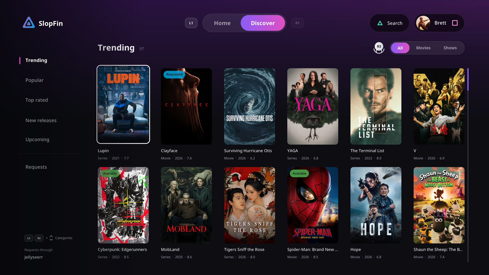

# Discover and requests

Discover is the second tab in the top bar: press R1 to open it and L1 to return to
Home. It can be hidden in Settings → Navigation. Connect Seerr or Jellyseerr to browse
trending titles, search for a movie or series, request it and follow its download.
An Overseerr-compatible server can use API-key or local-account authentication.

## Connect

Choose **Connect request server** in an unconfigured Discover screen, or open
**Settings → Discover**.

1. Enter the **Server address** for Seerr, Jellyseerr or Overseerr, rather than
   your Jellyfin media-server address. `request.example.com` uses verified HTTPS;
   a bare local IP uses HTTP on port 5055. Explicit protocols, ports and base
   paths are supported.
2. Choose **Sign in with** (Left/Right): Jellyfin account, Seerr account, or API key.
3. Enter the fields shown for that method, then choose **Connect**.

A status card at the top of the page shows whether SlopFin is connected, to
which server and version, or why the last attempt failed. Once connected, the
last row becomes **Disconnect**.

API keys come from the request server's Settings → General. They act as its
owner, so requests and the Requests list use that account. Use account sign-in when
you want requests credited to your own user. Keys can be revoked or rotated
on the server. Disconnect removes saved request credentials and keeps your
Jellyfin sign-in.

## Browse and request

Discover's sidebar picks what you are looking at: **Trending**, **Popular**,
**Top rated**, **New releases**, **Upcoming**, or **Requests**. Moving through it
opens each one straight away.

| Control | Action |
| --- | --- |
| Triangle | Open Search (Refresh on Requests); press Cross to type, or R3 to speak |
| D-pad | Browse titles; Up from the first row reaches the media filter |
| Cross | Open a title, then choose its action |
| R3 | Cycle All / Movies / Shows outside Search; start local voice input inside Search |
| Hold L2 or R2 + Up/Down | Next or previous Discover category |
| L1 | Back to the Home tab |
| Square | Your profile menu |
| Circle | Dismiss the keyboard, cancel voice input, close Search or return to the sidebar |

Availability badges come from the request server. Approved or queued titles
show **Requested** in the catalog. Requests shows actual download progress
when the server provides it.
Choose the media filter before opening Search. Dismissing the keyboard or
cancelling voice input keeps Search open; another Circle closes Search.
The All / Movies / Series filter sits beside the category's name; Left/Right
choose while it is focused, and changes apply immediately. These catalogs use
the server's discovery endpoints; search uses the server's relevance order, and
choosing a category clears the search. Top rated requires at least 200 votes;
New releases excludes future dates and requires 10 votes to reduce empty entries.
Titles load a few upstream pages at a time and more arrive as you scroll toward
the end, up to 600 titles. A scrollbar shows your position. The selected title
stays focused as more results arrive. The right stick scrolls the catalog and
Requests continuously: it eases in, speeds up to double after about a second
held, and glides to a stop when let go. A category seen in the last three
minutes reopens at once from memory; a request, cancellation or Clear Data
forgets them. When the request server is a LAN address, posters come through
its `/imageproxy` over plain HTTP instead of from TMDB directly. Requests has no filters.

## Seasons and quality

Open a title to review its request options before sending anything:

- **Quality profile:** Left/Right cycles the profiles provided by Sonarr or
  Radarr. The configured default is selected initially. Accounts need Seerr's
  advanced-request or request-management permission to override it; other
  accounts use the server default and see an explanation.
- **Download server:** choose between configured services when your account
  permits it. A **Standard / 4K** control appears when a 4K service is configured
  and your account can request 4K. Profiles such as Ultra-HD can also exist on
  an ordinary service; profile names come from your server.
- **Seasons:** Up/Down moves through the list; Cross toggles an individual
  missing season. Available and pending seasons are labelled and cannot be
  selected again. **Triangle** or Right opens the focused season’s episode guide,
  including available and pending seasons. Episode entries are read-only;
  requests are made by season. Specials can be selected separately. Square
  selects missing regular seasons or clears the selection. If the server disables partial
  requests, SlopFin follows its all-missing-seasons policy.

**Options** focuses the request button. Review the selected profile and season
count, then press Cross to submit. Circle closes without requesting anything.
Server quotas, approval rules and account permissions still apply.

Existing and completed requests show their saved quality profile as read-only.
SlopFin resolves the saved profile ID against its original download server. If
that profile cannot be resolved, its ID is shown instead of the current default. **Cancel request**
is the main action when your account can remove that request; otherwise it shows
a disabled **Requested** state. Available titles cannot be requested again.
Available titles with a Jellyfin item ID offer **Open in Jellyfin**. Circle
returns to the same Discover view. The Jellyfin server you use in SlopFin must
contain that item and allow your account to access it.

## Follow downloads

Requests made in SlopFin are remembered across app restarts. While the app is
open, a background check polls up to four tracked requests every five seconds,
including while you browse Jellyfin or play a video. Completed movies and newly
completed requested seasons refresh Home's latest rows without changing your
screen or scroll position. Additional refreshes for two minutes allow Jellyfin's
library scan to catch up. Availability depends on Seerr and Jellyfin reporting
the import; SlopFin cannot show a file before Jellyfin indexes it.

Requests loads the signed-in account's requests, newest first (up to 2,000
entries). Up/Down selects a request; Triangle refreshes immediately.
Season counts, 4K and quality-profile names appear when supplied by the server.

The list refreshes about every five seconds during downloads, or every 30 seconds
otherwise, without moving your selection.
Active download entries show progress, remaining bytes, a measured speed and
the server's ETA when available. Speed appears after a second sample. Names
and artwork fill in as detail lookups finish. Progress depends on the request
server's Sonarr/Radarr and downloader integration.

Open a request and choose **Cancel request** to review removal. Seerr allows
ordinary users to remove their own pending requests; administrators and request
managers can remove other request states. The confirmation explains that library
files stay and downloads already sent to Sonarr/Radarr may continue. The server
makes the final permission decision.

Administrators and request managers can also choose **Clear Data** beside the
main action. After confirmation, it clears Seerr’s tracking for the whole title,
including seasons and standard/4K requests. It does not delete library files or
cancel downloads already queued. Use it to reset stuck tracking; an available
title can reappear after the server scans the library.

The address, API key or session is saved in the console's protected
`/data/slopfin/config.json`. Passwords are used only for sign-in and are not
saved. Discover does not install or configure Sonarr, Radarr or a downloader.
