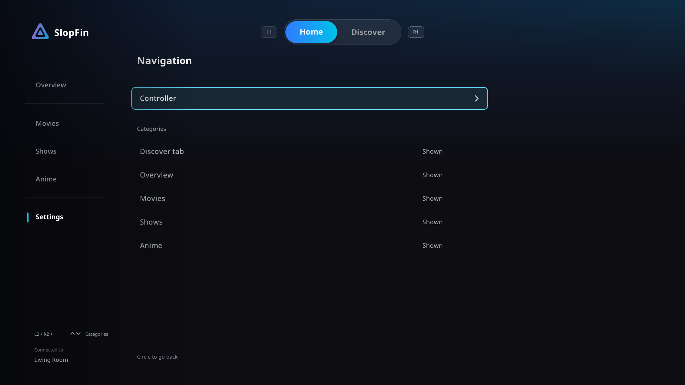

# Install and connect

You need a jailbroken PS5, a homebrew loader that can launch app folders, and
a Jellyfin account with access to movies or TV. Firmware **8.20** is the main
tested environment.

## Install the folder download

1. Open [Releases](https://github.com/BeLikeBrett/SlopFin/releases) and download
   the folder ZIP from a published preview.
2. Extract it and transfer the **complete `PPSA99001` folder** to your loader's
   homebrew directory, commonly `/data/homebrew/`.
3. Let your loader register the title, then open SlopFin from the PS5 menu.

For an upgrade, close SlopFin before replacing files. Keep
`/data/slopfin/config.json`; it contains your sign-in and settings.

## Enter your server

First launch shows a welcome page with one **Server address** field. Select it
to open the PlayStation keyboard; confirming the address connects straight away.
**Continue** retries the same address.

| Example | Connection |
| --- | --- |
| `media.example.com` | HTTPS on port 443 |
| `https://media.example.com` | The same HTTPS connection |
| `https://media.example.com/jellyfin` | HTTPS with a server base path |
| `192.168.1.20` | HTTP on Jellyfin's default port 8096 |
| `http://192.168.1.20:8096` | Explicit local connection |

Include the protocol when you need to override the default. HTTPS verifies
certificates and never falls back to HTTP automatically. Self-signed
certificates and IPv6 addresses are unsupported.

## Sign in

The sign-in page offers both ways side by side. **Quick Connect** shows a code
straight away: approve it from a phone or computer already signed in to Jellyfin
(Settings → Quick Connect) and SlopFin continues by itself. A code that expires
is replaced automatically.

Or fill in **Username and password** on the right. Confirming the password on
the keyboard signs in; Triangle shows or hides it. A failed sign-in keeps your
username and leaves the Quick Connect code working. Circle returns to the server
address.

SlopFin remembers the sign-in. If the server cannot be reached when the app
starts, it keeps trying for a few seconds, then shows **Can't reach your
server** with the sign-in still saved: choose Continue once the server is back.
Only a server that rejects the saved sign-in asks you to sign in again.

## Start watching

Use the sidebar to choose a library. Triangle opens Search; Square opens your
profile menu. [Controls](CONTROLS.md) explains DualSense seeking and playback
shortcuts. [Compatibility](COMPATIBILITY.md) covers codecs and output limits.

Use **Settings → Audio/Video** for optional audio decoding, HDMI passthrough
and Dolby Vision HDR10 fallback. [Playback stats](PLAYBACK_STATS.md) explains who
decodes or converts each stream.

Folder builds from 01.000.003 include **Settings → Updates**. Older public
01.000.000 builds need one manual folder upgrade to obtain it.
[Update status and requirements](UPDATES.md).

Use **Settings → Navigation** to reorder or hide Home, Discover and library
categories. Controller options are inside Navigation. To change your Jellyfin
server, sign out in **Settings → Account** and enter another address on the sign-in screen.

For a source build, use the [developer build guide](development/BUILD.md).

